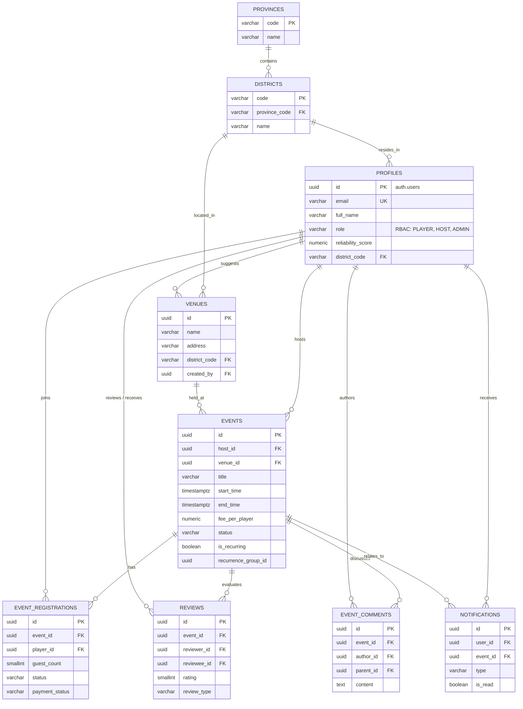
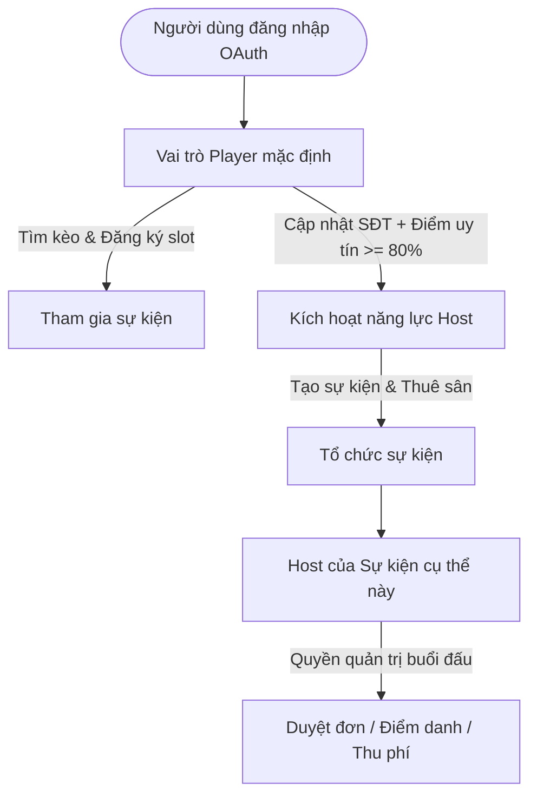

# 🏸 RallyMax - Nền Tảng Kết Nối & Tổ Chức Kèo Cầu Lông Phong Trào

[](https://vitejs.dev/)
[](https://react.dev/)
[](https://www.typescriptlang.org/)
[](https://astryx.design)
[](https://supabase.com/)

**RallyMax** là giải pháp số hóa toàn diện dành cho cộng đồng cầu lông phong trào: giúp người chơi (**Player**) dễ dàng tìm kiếm buổi đánh phù hợp theo khu vực/trình độ, hỗ trợ người tổ chức (**Host**) quản lý đơn đăng ký, duyệt thành viên, điểm danh, thu phí sân và theo dõi chuỗi kèo định kỳ; đồng thời cung cấp công cụ quản trị dành cho **Admin**.

---

## ✨ Cập Nhật Mới Nhất (Recent Highlights)

- 🛡️ **Phân quyền Role-Based hoàn toàn qua Database**: Không còn hardcode email; quyền hạn tự động phân định theo `currentUser.role` (`ADMIN`, `HOST`, `PLAYER`) lưu tại Supabase `profiles`.
- 🔁 **Tổ chức Kèo định kỳ (Recurring Events)**: Tự động nhân bản chuỗi kèo theo tuần (`WEEKLY`) hoặc ngày (`DAILY`) lên tới 12 buổi kèm huy hiệu chuỗi và bộ chuyển ngày nhanh.
- 🏸 **Bảo vệ trải nghiệm người chơi (Early UX Guard)**: Ẩn các nút tạo/sao chép kèo đối với tài khoản `PLAYER` và cảnh báo ngay tại bước mở modal để tránh lãng phí thời gian điền form.

👉 *Xem chi tiết toàn bộ lịch sử thay đổi tại [CHANGELOG.md](CHANGELOG.md).*

---

## 📑 MỤC LỤC
1. [⚡ Bắt đầu nhanh (Quickstart cho Developer)](#-bắt-đầu-nhanh-quickstart-cho-developer)
2. [📁 Cấu trúc thư mục dự án](#-cấu-trúc-thư-mục-dự-án)
3. [🗄️ Hướng dẫn thiết lập Supabase Database & Auth](#️-hướng-dẫn-thiết-lập-supabase-database--auth)
   - [Bước 1: Tạo dự án Supabase](#bước-1-tạo-dự-án-supabase)
   - [Bước 2: Cấu hình OAuth (Google & Facebook)](#bước-2-cấu-hình-oauth-google--facebook)
   - [Bước 3: Thiết lập CSDL & Sơ đồ dữ liệu (Database Schema)](#bước-3-thiết-lập-csdl--sơ-đồ-dữ-liệu-database-schema)
   - [Bước 4: Cấu hình Trigger tự động đồng bộ Profile](#bước-4-cấu-hình-trigger-tự-động-đồng-bộ-profile)
   - [Bước 5: Cấu hình Storage Bucket (Avatar & Event Covers)](#bước-5-cấu-hình-storage-bucket-avatar--event-covers)
   - [Bước 6: Cấu hình biến môi trường (.env)](#bước-6-cấu-hình-biến-môi-trường-env)
   - [Bước 7: Import danh mục sân đấu mẫu](#bước-7-import-danh-mục-sân-đấu-mẫu)
4. [🛡️ Kiến trúc phân quyền & bảo mật (RBAC & RLS)](#️-kiến-trúc-phân-quyền--bảo-mật-rbac--rls)
   - [Mô hình quyền hạn](#mô-hình-quyền-hạn)
   - [Ma trận phân quyền (Permission Matrix)](#ma-trận-phân-quyền-permission-matrix)
   - [Chính sách Row Level Security (RLS)](#chính-sách-row-level-security-rls)
   - [Kiểm soát quyền trên Frontend](#kiểm-soát-quyền-trên-frontend)
   - [Cơ chế Chống bùng kèo & Điểm uy tín](#cơ-chế-chống-bùng-kèo--điểm-uy-tín)
5. [🎨 Tiêu chuẩn thiết kế & Quy ước code (Astryx UI)](#-tiêu-chuẩn-thiết-kế--quy-ước-code-astryx-ui)
6. [📚 Tài liệu liên quan & Lịch sử thay đổi](#-tài-liệu-liên-quan--lịch-sử-thay-đổi)

---

## ⚡ Bắt Đầu Nhanh (Quickstart cho Developer)

### 1. Yêu cầu môi trường
- **Node.js**: $\ge 18.x$
- **Package Manager**: **`pnpm`** $\ge 9.x$ *(Bắt buộc dùng `pnpm` theo cấu hình workspace)*

### 2. Cài đặt và khởi chạy

```bash
# 1. Clone repository
git clone https://github.com/nidhong99/RallyMax.git
cd RallyMax

# 2. Cài đặt các gói phụ thuộc
pnpm install

# 3. Tạo file biến môi trường từ template
cp .env.example .env

# 4. Cập nhật thông tin Supabase vào .env (xem mục Thiết lập Supabase bên dưới)
# VITE_SUPABASE_URL=https://<your-project-ref>.supabase.co
# VITE_SUPABASE_ANON_KEY=eyJhbGciOi...

# 5. Khởi chạy ứng dụng ở chế độ phát triển
pnpm dev
```
Ứng dụng sẽ khả dụng tại: `http://localhost:5173`

---

## 📁 Cấu Trúc Thư Mục Dự Án

```text
RallyMax/
├── .env.example             # Template biến môi trường Supabase
├── AGENTS.md                # Hướng dẫn quy tắc code cho AI / Astryx UI CLI
├── CHANGELOG.md             # Lịch sử cập nhật tính năng
├── README.md                # Tài liệu onboarding tổng hợp (Tệp hiện tại)
├── package.json             # Cấu hình scripts & dependencies
├── pnpm-workspace.yaml      # Cấu hình build dependencies Astryx
├── scripts/
│   └── import_venues.cjs    # Script import dữ liệu sân hàng loạt vào Supabase
├── supabase/
│   ├── schema.sql           # Toàn bộ mã DDL SQL khởi tạo cơ sở dữ liệu
│   └── migrations/          # Các tệp SQL migration
└── src/
    ├── App.tsx              # Component gốc, tab routing & state tổng thể
    ├── main.tsx             # Entry point (nạp CSS Astryx core & reset)
    ├── components/          # Giao diện thành phần (Design System Astryx)
    │   ├── Navigation.tsx   # Top navbar, switch role & profile menu
    │   ├── EventCard.tsx    # Card hiển thị kèo, badges trạng thái
    │   ├── EventExplorer.tsx# Bộ lọc & danh sách tìm kèo
    │   ├── CreateEventModal.tsx # Modal tạo kèo đơn / lặp lại định kỳ
    │   ├── EventDetailModal.tsx # Chi tiết buổi chơi, duyệt thành viên, QR thanh toán
    │   ├── MyEventsView.tsx # Quản lý kèo tôi tham gia & kèo tôi tổ chức
    │   ├── AdminDashboardView.tsx # Dashboard quản trị Sân & Người dùng
    │   └── ...
    ├── context/
    │   └── AppContext.tsx   # Quản lý phiên đăng nhập, vai trò active, guards
    ├── constants/
    │   └── locations.ts     # Danh mục tỉnh thành / quận huyện Việt Nam
    ├── i18n/                # Hệ thống đa ngôn ngữ (Tiếng Việt & English)
    ├── lib/
    │   └── supabase.ts      # Supabase Client SDK instance
    └── types/
        └── database.ts      # Khai báo TypeScript types chuẩn cho DB
```

---

## 🗄️ Hướng Dẫn Thiết Lập Supabase Database & Auth

### Bước 1: Tạo dự án Supabase
1. Truy cập [https://supabase.com](https://supabase.com) và đăng nhập bằng GitHub.
2. Nhấn **"New project"**, chọn Organization.
3. Nhập tên dự án: `RallyMax`.
4. Đặt mật khẩu database an toàn và lưu lại.
5. **Region**: Khuyên chọn `Singapore (ap-southeast-1)` để có độ trễ thấp nhất về Việt Nam.
6. Chọn gói `Free plan` > Nhấn **"Create new project"** (chờ 1-2 phút để khởi tạo).

---

### Bước 2: Cấu hình OAuth (Google & Facebook)

#### 2.1 Google OAuth
1. Vào [Google Cloud Console](https://console.cloud.google.com/) > Tạo Project mới (ví dụ: `RallyMax Badminton`).
2. Vào **APIs & Services** > **OAuth consent screen** > Chọn **External** > Điền thông tin App.
3. Vào **Credentials** > **+ CREATE CREDENTIALS** > **OAuth client ID** > Loại **Web application**.
4. Tại **Authorized redirect URIs**, thêm callback từ Supabase:
   ```text
   https://<YOUR_SUPABASE_PROJECT_REF>.supabase.co/auth/v1/callback
   ```
5. Lưu lại **Client ID** và **Client Secret**.
6. Tại **Supabase Dashboard** > **Authentication** > **Providers** > Bật **Google** > Dán Client ID & Secret > Nhấn **Save**.

#### 2.2 Cấu hình URL Redirect trên Supabase
1. Tại Supabase Dashboard, vào **Authentication** > **URL Configuration**.
2. **Site URL**: `http://localhost:5173`
3. **Redirect URLs**: Thêm các URL được phép callback:
   - `http://localhost:5173/**`
   - `http://localhost:3000/**`
   - Domain production sau này (ví dụ: `https://rallymax.vn/**`).

---

### Bước 3: Thiết lập CSDL & Sơ đồ dữ liệu (Database Schema)

Toàn bộ mã SQL DDL khởi tạo cơ sở dữ liệu đã được tách riêng và lưu trữ tập trung tại [`supabase/schema.sql`](supabase/schema.sql).

> 💡 **Cách thực thi:**
> 1. Mở **Supabase Dashboard** > **SQL Editor** (`>_`) > **+ New query**.
> 2. Sao chép và dán toàn bộ nội dung từ tệp [`supabase/schema.sql`](supabase/schema.sql) rồi nhấn **Run**.
> 3. Hướng dẫn chi tiết từng bước vui lòng xem tại [SUPABASE_SETUP_GUIDE.md](SUPABASE_SETUP_GUIDE.md).

#### 🗂️ 1. Cấu Trúc Tổng Quan (Schema Tree)

```text
Database Schema (PostgreSQL / Supabase)
├── provinces                  # Danh mục Tỉnh / Thành phố (code, name)
├── districts                  # Quận / Huyện (code, province_code -> provinces.code)
├── profiles                   # Hồ sơ & Phân quyền RBAC (id -> auth.users, role: PLAYER | HOST | ADMIN)
├── venues                     # Sân cầu lông (id, name, address, district_code -> districts.code)
├── events                     # Kèo đấu & Chuỗi định kỳ (id, host_id -> profiles.id, venue_id -> venues.id)
├── event_registrations        # Đăng ký slot & Điểm danh (event_id -> events.id, player_id -> profiles.id)
├── reviews                    # Đánh giá 2 chiều (event_id -> events.id, reviewer/reviewee -> profiles.id)
├── event_comments             # Bình luận trao đổi kèo (event_id -> events.id, author_id -> profiles.id)
└── notifications              # Thông báo người dùng (user_id -> profiles.id, event_id -> events.id)
```

#### 📊 2. Sơ Đồ Thực Thể Liên Kết (Entity-Relationship Diagram)



#### 📋 3. Bảng Tra Cứu Các Thực Thể (Entity Directory)

| Tên Bảng | Chức năng & Vai trò nghiệp vụ | Khóa chính (PK) | Khóa ngoại & Liên kết chính (FK) |
| :--- | :--- | :--- | :--- |
| `provinces` | Danh mục Tỉnh / Thành phố chuẩn hóa (BCNF) | `code` (VD: `HN`, `HCM`) | Không |
| `districts` | Danh mục Quận / Huyện phục vụ lọc vị trí theo khu vực | `code` (VD: `HN_CG`) | `province_code` $\to$ `provinces.code` |
| `profiles` | Hồ sơ cá nhân, phân quyền RBAC (`role`) & điểm uy tín | `id` (UUID) | `id` $\to$ `auth.users.id`, `district_code` $\to$ `districts.code` |
| `venues` | Danh bạ sân cầu lông, định vị tọa độ và bản đồ | `id` (UUID) | `district_code` $\to$ `districts.code`, `created_by` $\to$ `profiles.id` |
| `events` | Buổi đấu cầu do Host tạo; hỗ trợ chuỗi lặp lại định kỳ | `id` (UUID) | `host_id` $\to$ `profiles.id`, `venue_id` $\to$ `venues.id` |
| `event_registrations` | Lượt đăng ký slot, số khách kèm, trạng thái thanh toán & điểm danh | `id` (UUID) | `event_id` $\to$ `events.id`, `player_id` $\to$ `profiles.id` |
| `reviews` | Đánh giá 2 chiều (Host $\leftrightarrow$ Player) tính điểm uy tín | `id` (UUID) | `event_id` $\to$ `events.id`, `reviewer_id` & `reviewee_id` $\to$ `profiles.id` |
| `event_comments` | Trao đổi, hỏi đáp và bình luận dạng cây (nested thread) | `id` (UUID) | `event_id` $\to$ `events.id`, `author_id` $\to$ `profiles.id`, `parent_id` $\to$ `event_comments.id` |
| `notifications` | Hộp thư thông báo kết quả duyệt đơn, hủy kèo, nhắc giờ chơi | `id` (UUID) | `user_id` $\to$ `profiles.id`, `event_id` $\to$ `events.id` |

---

### Bước 4: Cấu hình Trigger tự động đồng bộ Profile

Chạy script sau trong SQL Editor để tự động tạo profile khi người dùng đăng nhập lần đầu qua Google/Facebook OAuth:

```sql
CREATE OR REPLACE FUNCTION public.handle_new_user()
RETURNS TRIGGER AS $$
DECLARE
    raw_name TEXT;
    raw_avatar TEXT;
    raw_phone TEXT;
BEGIN
    raw_name := COALESCE(
        NEW.raw_user_meta_data->>'full_name',
        NEW.raw_user_meta_data->>'name',
        split_part(NEW.email, '@', 1)
    );
    raw_avatar := COALESCE(
        NEW.raw_user_meta_data->>'avatar_url',
        NEW.raw_user_meta_data->>'picture'
    );
    raw_phone := NEW.raw_user_meta_data->>'phone';

    INSERT INTO public.profiles (
        id,
        email,
        full_name,
        avatar_url,
        phone_number,
        gender,
        skill_level,
        role,
        is_verified_host,
        reliability_score
    ) VALUES (
        NEW.id,
        NEW.email,
        raw_name,
        raw_avatar,
        raw_phone,
        'OTHER',
        'BEGINNER',
        'PLAYER',
        FALSE,
        100.00
    )
    ON CONFLICT (id) DO UPDATE SET
        full_name = COALESCE(public.profiles.full_name, EXCLUDED.full_name),
        avatar_url = COALESCE(public.profiles.avatar_url, EXCLUDED.avatar_url),
        updated_at = NOW();

    RETURN NEW;
END;
$$ LANGUAGE plpgsql SECURITY DEFINER;

DROP TRIGGER IF EXISTS on_auth_user_created ON auth.users;
CREATE TRIGGER on_auth_user_created
    AFTER INSERT ON auth.users
    FOR EACH ROW EXECUTE FUNCTION public.handle_new_user();
```

---

### Bước 5: Cấu hình Storage Bucket (Avatar & Event Covers)

1. Vào menu **Storage** trên Supabase Dashboard > Nhấn **"New bucket"**:
   - Bucket 1: `avatars` (Bật **Public bucket** = ON).
   - Bucket 2: `event-covers` (Bật **Public bucket** = ON).
2. Chạy SQL cấp quyền upload trong SQL Editor:

```sql
-- Cho phép đọc công khai
CREATE POLICY "Public Access" ON storage.objects 
FOR SELECT USING (bucket_id IN ('avatars', 'event-covers'));

-- Cho phép upload khi đã đăng nhập
CREATE POLICY "Authenticated users can upload avatar" ON storage.objects 
FOR INSERT WITH CHECK (bucket_id = 'avatars' AND auth.role() = 'authenticated');

CREATE POLICY "Authenticated users can upload event covers" ON storage.objects 
FOR INSERT WITH CHECK (bucket_id = 'event-covers' AND auth.role() = 'authenticated');
```

---

### Bước 6: Cấu hình biến môi trường (.env)

Lấy thông tin từ **Project Settings** > **API**:
- **Project URL**
- **Project API Keys**: Copy khóa **`anon` / `public`**

Tạo file `.env` tại thư mục gốc dự án:
```env
VITE_SUPABASE_URL=https://<YOUR_PROJECT_REF>.supabase.co
VITE_SUPABASE_ANON_KEY=eyJhbGciOi...
```

---

### Bước 7: Import danh mục Sân đấu mẫu

Hệ thống cung cấp sẵn script tự động nạp dữ liệu sân đấu chuẩn vào Supabase:

```bash
# Quét và import toàn bộ danh mục sân các quận tại Hà Nội / TP.HCM
node scripts/import_venues.cjs all
```

---

## 🛡️ Kiến Trúc Phân Quyền & Bảo Mật (RBAC & RLS)

### Mô hình quyền hạn
RallyMax áp dụng mô hình phân quyền **Contextual Role & Hybrid Verification**:
- **PLAYER (Mặc định)**: Tìm kiếm kèo, đăng ký slot, chat, quản lý đơn của mình.
- **HOST (Chủ xị)**: Được kích hoạt khi hồ sơ có SĐT và điểm uy tín $\ge 80\%$. Có quyền tạo kèo, duyệt/từ chối người chơi, điểm danh, xác nhận chuyển khoản.
- **ADMIN**: Ban quản trị có toàn quyền quản lý sân bãi, duyệt danh mục, và quản lý người dùng.



---

### Ma Trận Phân Quyền (Permission Matrix)

| Thực thể / Tính năng | Player (Người chơi) | Host (Chủ xị của Event) | Admin (Quản trị viên) | Khách vãng lai |
| :--- | :--- | :--- | :--- | :--- |
| **Hồ sơ cá nhân (Profiles)** | Xem tất cả, chỉ sửa của mình | Xem tất cả, chỉ sửa của mình | Xem và quản trị tất cả | Chỉ xem thông tin công khai |
| **Khám phá kèo (Events)** | Xem tất cả kèo mở | Xem tất cả các kèo | Toàn quyền kiểm duyệt | Xem danh sách công khai |
| **Tạo kèo mới (Create Event)** | Bị chặn (chuyển hướng kích hoạt Host) | **Có quyền** | **Có quyền** | Không |
| **Sửa / Hủy kèo** | Không | **Chỉ Host tạo kèo đó** | Có quyền can thiệp | Không |
| **Đăng ký tham gia** | **Đăng ký slot, vào waitlist** | Không tự đăng ký kèo của mình | Có thể đăng ký | Cần đăng nhập |
| **Duyệt / Từ chối đơn** | Không | **Có toàn quyền trên kèo của mình** | Có quyền | Không |
| **Điểm danh ("Có mặt" / "Báo bùng")** | Không | **Có toàn quyền** | Có quyền | Không |
| **Xác nhận thanh toán** | Báo "Đã chuyển khoản" | **Xác nhận "Đã thu"** | Xem trạng thái | Không |
| **Quản trị Sân đấu (Venues)** | Xem danh sách sân | Xem danh sách sân | Thêm / Sửa / Đồng bộ sân | Xem danh mục |

---

### Chính Sách Row Level Security (RLS)

Chạy script sau trong Supabase SQL Editor để kích hoạt bảo vệ dữ liệu ở tầng PostgreSQL:

```sql
-- 1. Bật RLS
ALTER TABLE public.profiles ENABLE ROW LEVEL SECURITY;
ALTER TABLE public.events ENABLE ROW LEVEL SECURITY;
ALTER TABLE public.event_registrations ENABLE ROW LEVEL SECURITY;
ALTER TABLE public.reviews ENABLE ROW LEVEL SECURITY;

-- 2. Profiles Policies
DROP POLICY IF EXISTS "Public profiles are viewable by everyone" ON public.profiles;
CREATE POLICY "Public profiles are viewable by everyone" ON public.profiles FOR SELECT USING (true);

DROP POLICY IF EXISTS "Users can update their own profile" ON public.profiles;
CREATE POLICY "Users can update their own profile" ON public.profiles FOR UPDATE USING (auth.uid() = id);

-- 3. Events Policies
DROP POLICY IF EXISTS "Events are viewable by everyone" ON public.events;
CREATE POLICY "Events are viewable by everyone" ON public.events FOR SELECT USING (status != 'DRAFT' OR host_id = auth.uid());

DROP POLICY IF EXISTS "Hosts can create events" ON public.events;
CREATE POLICY "Hosts can create events" ON public.events FOR INSERT WITH CHECK (
    auth.role() = 'authenticated' AND auth.uid() = host_id
);

DROP POLICY IF EXISTS "Host can update their own event" ON public.events;
CREATE POLICY "Host can update their own event" ON public.events FOR UPDATE USING (auth.uid() = host_id);

DROP POLICY IF EXISTS "Host can delete their own event" ON public.events;
CREATE POLICY "Host can delete their own event" ON public.events FOR DELETE USING (auth.uid() = host_id);

-- 4. Event Registrations Policies
DROP POLICY IF EXISTS "View registrations policy" ON public.event_registrations;
CREATE POLICY "View registrations policy" ON public.event_registrations FOR SELECT USING (
    player_id = auth.uid() OR 
    EXISTS (SELECT 1 FROM public.events e WHERE e.id = event_registrations.event_id AND e.host_id = auth.uid())
);

DROP POLICY IF EXISTS "Player can register for event" ON public.event_registrations;
CREATE POLICY "Player can register for event" ON public.event_registrations FOR INSERT WITH CHECK (
    auth.role() = 'authenticated' AND 
    player_id = auth.uid() AND
    NOT EXISTS (SELECT 1 FROM public.events e WHERE e.id = event_id AND e.host_id = auth.uid())
);

DROP POLICY IF EXISTS "Update registrations policy" ON public.event_registrations;
CREATE POLICY "Update registrations policy" ON public.event_registrations FOR UPDATE USING (
    player_id = auth.uid() OR
    EXISTS (SELECT 1 FROM public.events e WHERE e.id = event_registrations.event_id AND e.host_id = auth.uid())
);
```

---

### Kiểm Soát Quyền Trên Frontend

Frontend kiểm soát quyền hạn theo thời gian thực dựa trên trạng thái `currentUser.role` từ Supabase Database:
- **`src/context/AppContext.tsx`**: Cung cấp các helper methods `canCreateEvent()`, `isHostOfEvent()`, `isCurrentUserAdmin`.
- **`src/components/Navigation.tsx`**: Ẩn nút "+ Tạo kèo" đối với tài khoản `PLAYER`; chỉ hiện bảng điều khiển Admin đối với `ADMIN`.
- **`src/components/CreateEventModal.tsx`**: Chặn sớm (Early Guard) bằng thông báo cảnh báo và ẩn form nếu tài khoản là `PLAYER`.
- **`src/components/EventDetailModal.tsx`**: Phân chia giao diện rạch ròi: Host xem nút Duyệt/Hủy/Điểm danh; Player xem nút Đăng ký/Rút lui.

---

### Cơ Chế Chống Bùng Kèo & Điểm Uy Tín

1. **Điểm uy tín mặc định**: Mọi tài khoản khởi tạo với **100%**.
2. **Xử phạt bùng kèo (`NO_SHOW`)**:
   - Khi Host đánh dấu Player là `NO_SHOW`, hệ thống tự động trừ $5\%$ điểm uy tín.
   - Khi điểm uy tín $< 70\%$, Player sẽ bị hạn chế quyền đăng ký các kèo duyệt tự động.
3. **Khen thưởng tham gia**: Đánh giá 5 sao từ Host và hoàn thành buổi chơi nâng dần điểm uy tín và huy hiệu thành viên tích cực.

---

## 🎨 Tiêu Chuẩn Thiết Kế & Quy Ước Code (Astryx UI)

Dự án áp dụng hệ thống thiết kế **Astryx UI Design System (v0.7.0)**:
- **Không dùng thẻ `<div>` hoặc `<span>` thô**: Sử dụng các thành phần bố cục chuẩn như `VStack`, `HStack`, `Grid`, `Card`, `Box`, `Section`.
- **Quy tắc Style**: Sử dụng token màu sắc và khoảng cách (`var(--color-*)`, `var(--spacing-*)`, `var(--radius-*)`). Không dùng hardcoded hex color hoặc utility class ad-hoc.
- **Đa ngôn ngữ (i18n)**: Tất cả chuỗi hiển thị đều được cấu hình song ngữ tại `src/i18n/translations.ts` với hàm dịch `t('key')`.

---

## 📚 Tài Liệu Liên Quan & Lịch Sử Thay Đổi

- [CHANGELOG.md](CHANGELOG.md): Chi tiết các thay đổi gần đây (RBAC database-driven, recurring events, UX improvements).
- [ROLE_BASED_ACCESS_CONTROL_GUIDE.md](ROLE_BASED_ACCESS_CONTROL_GUIDE.md): Tài liệu chuyên sâu về kiến trúc phân quyền RBAC & RLS.
- [SUPABASE_SETUP_GUIDE.md](SUPABASE_SETUP_GUIDE.md): Bản hướng dẫn cài đặt cơ sở dữ liệu Supabase gốc.
- [AGENTS.md](AGENTS.md): Hướng dẫn phát triển và quy tắc tích hợp dành cho AI Agent.
- [supabase/migrations/](supabase/migrations/): Thư mục chứa các bản nâng cấp cấu trúc cơ sở dữ liệu.
